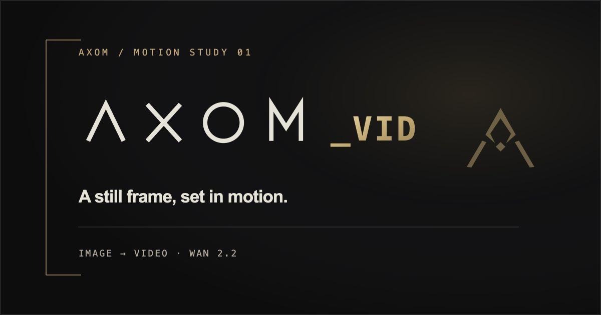

<div align="center">



# AXOM_VID

**Open-source image-to-video: unlimited local Mac attempts without paid credits, or optional quota-limited shared cloud rendering.**

[This deployment](https://jaclose.github.io/AXOM_VID/) · [Original NiftyVid demo](https://igorcsis.github.io/nifty-vid/) · [Original source](https://github.com/IgorCSIS/nifty-vid)


</div>

## What it does

Drop a photo, write a short motion prompt ("slow camera push, leaves drifting"), and generate an MP4. AXOM_VID has two distinct engines: **Local Mac** uses open-source Phosphene LTX image-to-video without a provider quota or per-video fees, while **Shared cloud GPU** sends a job to a free, quota-limited Hugging Face Wan 2.2 Space.

The public site is static and hosted on GitHub Pages. Its optional shared-cloud mode uses the deployment owner's Hugging Face quota. The **no-quota Mac mode requires the separate loopback studio** started on the user's own Mac; a public GitHub Pages page cannot run an offline model on a remote computer.

AXOM_VID is a separate image-to-video project that uses the AXOM visual identity. It is derived from [NiftyVid](https://github.com/IgorCSIS/nifty-vid) by Igor Lima under the MIT license; it is not part of the AXOM study app.

## Features

- Drag-and-drop or paste an image straight from the clipboard
- Live prompt with sensible defaults (duration, inference steps)
- In-session history strip with hover-to-preview
- Dark mode interface tuned for long sessions
- Download generated videos as MP4
- Zero tracking and no signup for visitors
- Clear error, retry, stop-waiting, and elapsed-time states; upstream failures without details no longer appear as `Failed: null`
- Live shared GPU allowance, including the daily run count and local reset time; exhausted accounts are blocked before image upload
- **Local Mac · no daily limit**: Phosphene LTX image-to-video, local queue progress, and MP4 downloads without a cloud inference account. Requires a locally running Mac GPU and a one-time model installation.

## Tech stack

| Layer | Choice |
|---|---|
| Frontend | Astro 4 + Tailwind 3 + TypeScript |
| Hosting | GitHub Pages (static) |
| Edge proxy | Cloudflare Worker (free tier) |
| Inference | Free local Phosphene LTX-2.5 on Apple Silicon; optional quota-limited Hugging Face Wan 2.2 |
| Tooling | pnpm 9, Wrangler 4, GitHub Actions |

## Architecture

```
[ browser ]  →  [ Cloudflare Worker ]  →  [ HF Space: Wan 2.2 ]
   GH Pages       axomvidjd.jafardabbagh.workers.dev
                  HF_TOKEN stored as a secret
```

The diagram above covers **shared cloud mode**. For unmetered local mode, the Astro app connects only to a localhost Python bridge at `127.0.0.1:8765`; that bridge talks to the Phosphene panel at `127.0.0.1:8198`, and video inference runs on the Mac GPU. No Cloudflare or Hugging Face generation service is involved. See [the local installation guide](local/README.md).

The Worker exists for two reasons. Browsers can't reliably call Hugging Face Spaces because of CORS, and we want one stable URL we control so the upstream backend can change without redeploying the static site. Today the Worker proxies to a public Space; tomorrow it could swap to fal.ai, Replicate, or a private Space without touching the frontend.

### The handoff

<p align="center">
  
</p>

The Worker checks the account's ZeroGPU allowance, uploads the image, submits the job with its server-held token, then
opens the upstream event stream and returns that stream to the browser. A
restricted download route streams the finished MP4 as an attachment. The Worker
does not buffer the generated clip or expose the token to the page. Its `/quota`
route returns only remaining GPU seconds, remaining runs, and reset times.

The price is that the browser has to speak SSE. `web/src/scripts/studio.ts`
buffers the stream, splits it on blank lines, and waits for the `complete`
event to pull the video URL out of the return tuple. That file and
`worker/src/index.ts` are two halves of one contract.

## No cloud run limit: local Mac studio

**Use this for unlimited local attempts without subscriptions or per-video inference charges.** You need an Apple Silicon Mac with adequate memory and disk space; 18 GB unified RAM supports Phosphene's reduced-memory LTX profile. The base installation uses about 27.5 GB and additional models about 10.7 GB, so use an external SSD if needed.

1. Install [Pinokio](https://desktop.pinokio.co/) and choose an external SSD as Pinokio Home in Settings if internal space is limited.
2. Install and start [Phosphene](https://github.com/mrbizarro/Phosphene) in Pinokio. Its panel runs at `http://127.0.0.1:8198`.
3. From **any Terminal directory**, clone or refresh AXOM_VID on the SSD and start it (this does not alter an existing Phosphene installation):

```bash
SSD="/Volumes/JDabSSD"
if ! test -d "$SSD"; then echo "External SSD is not mounted: $SSD"; else
  mkdir -p "$SSD/Developer"
  if test -d "$SSD/Developer/AXOM_VID/.git"; then
    git -C "$SSD/Developer/AXOM_VID" switch main
    git -C "$SSD/Developer/AXOM_VID" pull --ff-only
  else
    git clone https://github.com/jaclose/AXOM_VID.git "$SSD/Developer/AXOM_VID"
  fi
  cd "$SSD/Developer/AXOM_VID"
  bash local/start.command
fi
```

4. Open the **actual URL printed by the launcher** (8765 by default, or 8766–8775 if the default is already in use). Select **Local Mac** and generate 3–10-second clips or 30–120-second chained takes; optionally queue 1–6 generations. Completed clips offer MP4 and GIF downloads (GIF exports are capped at 15 seconds). The script prepares the small FFmpeg converter on the SSD when needed.

Your earlier `git switch main`, `git pull` and `bash local/start.command` attempt failed because the current directory was `~`, not a Git repository. The localhost URL refuses connections until this launcher is actually running.

This mode uses electricity, CPU/GPU time, memory, and local storage, and it may be slower and lower resolution than cloud NVIDIA hardware. It works only while the Mac and Phosphene are running. Read the [detailed installation and limitations](local/README.md) before attempting a model download. **The public website cannot supply a free unlimited cloud GPU.**

## ComfyUI and Phosphene integration acceptance

The Phosphene installation and ComfyUI/Glass Studio model libraries are managed separately on the external SSD. After the existing Phosphene download completes, run the local integration preflight without changing model files:

    python3 /Volumes/JDabSSD/Developer/AXOM_VID/local/acceptance.py

Its receipt is saved only on the SSD under local/reports/last-preflight.json. When it reports ready_to_render and no GPU job is active, the owning setup workflow can run a single real 3-second Quick test and validate the MP4/GIF:

    python3 /Volumes/JDabSSD/Developer/AXOM_VID/local/acceptance.py --render --max-minutes 90

See [the cross-conversation SSD handoff and acceptance criteria](local/COMFYUI_INTEGRATION_HANDOFF.md). A successful web request or downloaded model file alone is not proof that local inference works.

## Model-aware local creative studio

AXOM_VID now distinguishes *Phosphene's HTTP panel being online* from the **Q4 video model and its text encoder being ready**. The local page shows the installed model tier, integrity results, memory pressure, swap usage, and outstanding downloads. It automatically rechecks while installation is incomplete, and will not upload/generate if the required Gemma text encoder is still downloading.

On Apple Silicon, choose a creative recipe (Natural, Cinematic, Landscape, Product, Illustrated, or Dynamic), or open the advanced controls to customize:

- Camera (steady, push/pull, pan left/right, orbit, tracking, tilt), subtle/natural/dynamic motion, and visual treatment. These are prompt-based controls rather than pretending to manipulate unsupported model parameters.
- Landscape/portrait orientation, fixed or randomized seeds, and safe 512-pixel output. 640-pixel and 704-pixel longer-side resolutions are marked **experimental on an 18 GB Mac**.
- Quick/Balanced quality, 3–10 second clips or Phosphene's 30–120 second chained One Take mode. Optional storyboard beats let the user direct each five-second segment of a long take.
- Up to six queued generations, optional distinct motion prompts, local MP4 previews and GIF export. Personal settings are remembered only in this browser; source images and prompt text are **not** saved as preferences.
- **Use low-memory preset** restores Quick, 3 seconds, 512px, one job, without clearing the source image or main prompt.

The [October 30 Mac model and capability audit](local/MODEL_AUDIT_2026-10-30.md) records what is verified installed, downloading, missing, or excluded by the M3 Pro's 18 GB memory limit. It also distinguishes the short ComfyUI Wan 5B output from an actual high-quality video test. Reports from the local acceptance script stay inside the user's SSD checkout.

**Maximal settings warning:** The separate free cloud backend's 4.5-second/12-step synthetic test returned an upstream `event: error` with `data: null`; 1.5-second/3-step generation succeeded. Local LTX High/Q8 and Hailuo H3 are unsupported by the current machine's Phosphene capability tier. Longer and larger options are not automatically reliable or free of hardware limits.

## M3 Pro / 18 GB safe generation

The Mac's Phosphene panel may be online even when its GPU is **not safe to submit to**. After a recent Metal watchdog timeout while encoding prompts, AXOM_VID now checks the actual Phosphene job history for a 15-minute cooldown, its active download and GPU queue, ComfyUI's active queue, and Mac memory pressure before accepting new local video work.

The first verified local image-to-video job is deliberately limited to **one 3-second Quick 512px clip**. Longer takes, higher quality/resolution, or multiple queued variations are unlocked gradually only after a successful I2V and when resources permit. This does not affect the separate, quota-limited shared-cloud mode or delete any installed models. When a request is unsafe, the interface displays the specific reason instead of silently retrying.

See the [M3 Pro GPU recovery and low-memory workflow](local/M3_PRO_RECOVERY.md). Phosphene's optional Q8 model does not become runnable merely because its 30 GB weights are downloaded; the installed Compact tier reports `allows_q8: false` for this Mac.

## Run locally

You need Node 20+, [pnpm](https://pnpm.io/) 9+, and a clone of this repo. Both lockfiles are v9, which is what CI installs with. The local preview uses the deployed Worker by default, so you can start with the frontend alone:

```powershell
# Frontend (Astro dev server on :4321)
cd web
pnpm install
pnpm dev

```

Open http://localhost:4321 and try a generation. For independent local Worker development, create a [Hugging Face read token](https://huggingface.co/settings/tokens), put it in gitignored `worker/.dev.vars` as `HF_TOKEN=<your token>`, run `pnpm wrangler dev` from `worker/`, and put `PUBLIC_WORKER_URL=http://localhost:8787` in `web/.env`. Never place the token in `web/.env` or a `PUBLIC_` variable. The Worker `/health` route reports `configured: true` when it has a token; it never returns the token itself.

## Deploy

The static site deploys to [AXOM_VID on GitHub Pages](https://jaclose.github.io/AXOM_VID/) on pushes to `main` via [`.github/workflows/deploy.yml`](.github/workflows/deploy.yml). GitHub forks may require Actions to be enabled and **Settings → Pages → Build and deployment → GitHub Actions** to be selected first. The Worker, named `axomvidjd` in `worker/wrangler.toml`, is typechecked by [`.github/workflows/worker.yml`](.github/workflows/worker.yml) and deployed separately:

```powershell
cd worker
pnpm wrangler login
pnpm wrangler deploy
pnpm wrangler secret put HF_TOKEN
```

Set `PUBLIC_WORKER_URL` to `https://axomvidjd.jafardabbagh.workers.dev` under **Settings → Secrets and variables → Actions → Variables** in the fork. A new Pages build wires the frontend to the Worker. Check the Worker `/health` endpoint for `configured: true`, then test a generation on the public page. The Worker token must be added as a Cloudflare secret, never as a GitHub variable or a committed file.

## Limitations

- Generation starts at 1.5 seconds and 3 inference steps to favor a first result. Advanced options allow up to 4.5 seconds and 12 steps; longer clips use more GPU time and may fail on the shared Space.
- The upstream Space uses shared ZeroGPU hardware. Queues, cold starts, service failures, and daily account quota can interrupt generation. Free accounts can reach their daily run cap even with GPU seconds remaining; `/quota` reports both limits and the page shows the reset time. [Hugging Face documents its ZeroGPU quota API](https://huggingface.co/docs/huggingface_hub/guides/manage-spaces#track-your-zerogpu-quota). This Space requests an xlarge GPU, which uses quota at 2×. Every public visitor shares the token owner's quota. A paid or independently hosted backend is required for dependable public capacity.
- The upstream Space can change or disappear. A backend change may require updating `HF_SPACE_BASE` and the input mapping in `worker/src/index.ts`.
- Cloudflare [documents no hard wall-time limit for HTTP Workers while the client remains connected](https://developers.cloudflare.com/workers/platform/limits/). A broken browser connection or upstream stream can still stop a run.

## Roadmap

- [x] Stream Gradio events to the browser for queue and generation states
- [ ] Optional second keyframe ("last frame") for guided motion
- [ ] Saved generations across sessions (opt-in localStorage)
- [ ] Frame extraction tool to use a generated frame as the next input
- [ ] Swap-able backend: fal.ai for users with API keys

## Credits

- Original project: [NiftyVid](https://github.com/IgorCSIS/nifty-vid) by [Igor Lima](https://github.com/IgorCSIS), released under the MIT license
- [Wan 2.2](https://huggingface.co/Wan-AI/Wan2.2-I2V-A14B-Diffusers) by Alibaba Tongyi Lab
- The [`cbensimon/wan2-2-fp8da-aoti-preview2`](https://huggingface.co/spaces/cbensimon/wan2-2-fp8da-aoti-preview2) Hugging Face Space that hosts the inference
- [Astro](https://astro.build/), [Tailwind](https://tailwindcss.com/), and [Cloudflare Workers](https://workers.cloudflare.com/) for the boring-but-good parts

## License

MIT. See [LICENSE](LICENSE). The original NiftyVid attribution and license are retained in this derivative.
